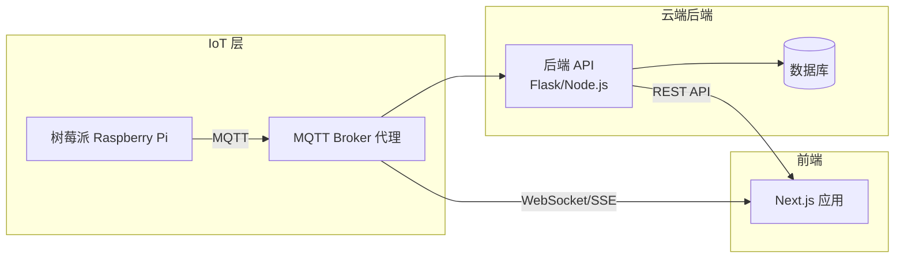
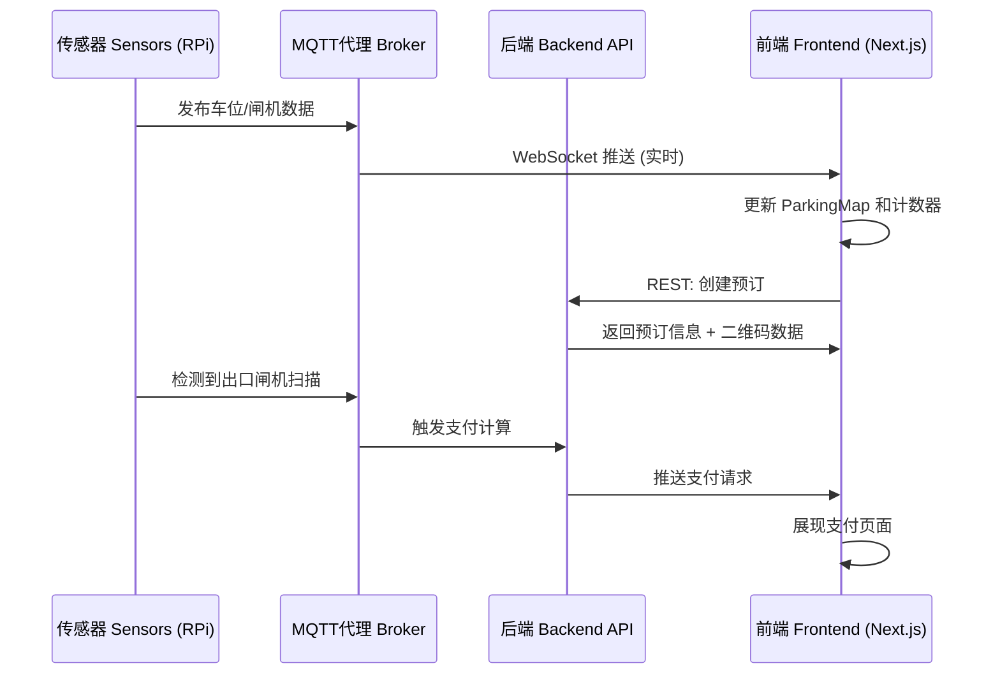

# 智能停车管理系统 — 前端实现计划

## 1. 项目背景摘要

**项目**: CITS5506 物联网 — 智能停车管理系统（第 19 组）

**您的角色 (Zihan Jia)**: 前端开发人员 — Web 仪表板 UI、停车数据展示、API 接口集成、系统测试与调试。

### 核心系统功能（前端相关）
| # | 功能 | 前端职责 |
|---|---------|------------------------|
| a | 实时车位监控 | 带有车位状态（空闲/占用/已预订）的实时停车地图 |
| b | 基于闸机的车辆计数 | 在仪表板上显示总车辆数 |
| c | 双重检测提高准确性 | 显示组合传感器状态/置信度指示器 |
| d | 基于二维码的闸机控制 | 用户注册 → 预订 → 二维码生成与显示 |
| e | 最短路径引导 | 在停车地图上显示动画路径引导 |
| f | 数据记录与分析 | 管理员数据分析仪表板（图表、表格） |
| g | 基于时间的出口支付 | 带有停车时长/费用显示的支付页面，支付网关集成 |
| h | 实时 Web 仪表板 | 自动更新车位状态、车辆数量和警报的实时仪表板 |

### 系统架构（前端视角）


---

## 2. 技术栈

| 层级 | 技术 | 选用原因 |
|-------|-----------|--------|
| 框架 | **Next.js 14 (App Router)** | SSR/SSG，基于文件的路由，用于 BFF (Backend For Frontend) 模式的 API 路由 |
| 语言 | **JavaScript** | 快速开发，符合团队技术栈 |
| 样式 | **Tailwind CSS** | 实用类优先，快速构建响应式界面，保持简洁 |
| 状态管理 | **React Context + useReducer** | 轻量级，足以应对此规模的项目 |
| 实时通信 | **WebSocket** | 建立持久连接，接收实时传感器数据 |
| 图表 | **Chart.js + react-chartjs-2** | 轻量级，非常适合入住率/收入图表 |
| 二维码 | **qrcode.react** | 客户端二维码渲染 |
| HTTP 客户端 | **fetch (原生)** | 无需额外依赖 |
| 图标 | **react-icons** | 全面的图标库 |

---

## 3. 项目结构

```
smart-parking-frontend/
├── public/
│   └── images/                   # 静态资源（停车场布局 SVG、Logo 等）
├── src/
│   ├── app/                      # Next.js App Router 目录
│   │   ├── layout.jsx            # 根布局（导航栏、页脚、全局 Provider）
│   │   ├── page.jsx              # 着陆页 / 首页
│   │   ├── globals.css           # 全局样式和 Tailwind 指令
│   │   ├── login/
│   │   │   └── page.jsx          # 登录页
│   │   ├── register/
│   │   │   └── page.jsx          # 注册页
│   │   ├── dashboard/
│   │   │   ├── page.jsx          # 用户主仪表板（停车地图 + 状态）
│   │   │   └── layout.jsx        # 带有侧边栏的仪表板布局
│   │   ├── booking/
│   │   │   ├── page.jsx          # 车位选择与预订
│   │   │   └── [id]/
│   │   │       └── page.jsx      # 预订详情 + 二维码展示
│   │   ├── payment/
│   │   │   ├── page.jsx          # 支付处理页面
│   │   │   └── success/
│   │   │       └── page.jsx      # 支付成功确认页面
│   │   ├── history/
│   │   │   └── page.jsx          # 预订与支付历史记录
│   │   ├── admin/
│   │   │   ├── page.jsx          # 管理员分析仪表板主页
│   │   │   ├── slots/
│   │   │   │   └── page.jsx      # 车位管理
│   │   │   └── analytics/
│   │   │       └── page.jsx      # 图表、热力图、收入统计
│   │   └── api/                  # BFF API 路由（可选的代理）
│   │       └── parking/
│   │           └── route.js
│   ├── components/
│   │   ├── common/               # 共享 UI 组件
│   │   │   ├── Navbar.jsx
│   │   │   ├── Footer.jsx
│   │   │   ├── Button.jsx
│   │   │   ├── Card.jsx
│   │   │   ├── Modal.jsx
│   │   │   ├── StatusBadge.jsx
│   │   │   └── LoadingSpinner.jsx
│   │   ├── parking/              # 停车专用组件
│   │   │   ├── ParkingMap.jsx         # 交互式 SVG 停车地图
│   │   │   ├── SlotIndicator.jsx      # 单个车位指示器（颜色编码）
│   │   │   ├── PathDisplay.jsx        # 静态最短路径展示层
│   │   │   ├── VehicleCounter.jsx     # 入口/出口计数显示
│   │   │   └── GateStatus.jsx         # 闸机开/关状态指示器
│   │   ├── booking/
│   │   │   ├── BookingForm.jsx
│   │   │   ├── QRCodeDisplay.jsx
│   │   │   └── SlotSelector.jsx
│   │   ├── payment/
│   │   │   ├── PaymentSummary.jsx
│   │   │   └── PaymentForm.jsx
│   │   └── analytics/
│   │       ├── OccupancyChart.jsx
│   │       ├── RevenueChart.jsx
│   │       ├── PeakHourHeatmap.jsx
│   │       └── TrafficTrendChart.jsx
│   ├── contexts/
│   │   ├── AuthContext.jsx        # 用户身份验证状态
│   │   └── ParkingContext.jsx     # 实时停车数据状态
│   ├── hooks/
│   │   ├── useWebSocket.js       # WebSocket 连接 Hook
│   │   ├── useAuth.js            # 身份验证辅助 Hook
│   │   ├── useParkingData.js     # 停车数据订阅 Hook
│   │   └── useBooking.js         # 预订操作 Hook
│   ├── lib/
│   │   ├── api.js                # 后端 API 客户端函数
│   │   ├── websocket.js          # WebSocket 客户端配置
│   │   ├── pathfinding.js        # 客户端 Dijkstra 可视化辅助函数
│   │   └── utils.js              # 实用函数（时间格式化、费用计算预览等）
└── next.config.js
```

---

## 4. 页面设计规范

> **UI 语言约定**: 所有前端界面（包括按钮、文案、表单提示、提示语等）必须**统一使用英文 (English)**。

### 4.1 着陆页 / 首页 (`/`)
- **英雄区域 (Hero section)**：简洁的停车插画，标语“智能停车，化繁为简 (Smart Parking, Simplified)”
- **功能卡片**：实时监控、扫码入场、自动支付、路径引导
- **行动号召 (CTA) 按钮**：“立即预订” / “查看仪表板”
- **设计风格**：使用 Tailwind 默认配色方案，结构清晰的卡片布局

### 4.2 登录与注册 (`/login`, `/register`)
- **表单字段**：邮箱、密码（登录）；+ 姓名、电话、车牌号（注册）
- **表单验证**：客户端验证，提供清晰的错误提示信息
- **设计风格**：简洁的居中表单卡片

### 4.3 用户仪表板 (`/dashboard`)
> **最重要的页面 — 实时停车可视化界面**

- **停车地图（中央区域）**：基础的 SVG/Canvas，展示 3 个停车位
  - 颜色编码车位：🟢 绿色 = 空闲，🔴 红色 = 占用，🔵 蓝色 = 已预订
  - 带有状态指示器的入口/出口闸机
  - 静态路径引导覆盖层（当用户有激活的预订时显示）
- **状态面板（侧边栏）**：
  - 停车场内总车辆数（来自闸机计数器）
  - 可用停车位数量
  - 每个车位的传感器读数
- **快捷操作**：预订车位、查看二维码、查询支付情况
- **自动刷新**：通过 WebSocket 订阅实现实时更新

### 4.4 预订流程 (`/booking`, `/booking/[id]`)
- **车位选择**：可视化的车位选择器（点击地图上的空闲车位）
- **预订确认**：所选车位、预计停车时长、价格预览
- **二维码展示 (`/booking/[id]`)**：
  - 用于在入口闸机扫描的大尺寸二维码
  - 预订详情（车位号、预订时间、状态）
  - “请在入口闸机处出示”的提示说明

### 4.5 支付页面 (`/payment`)
- **触发条件**：在出口闸机扫描二维码 → 后端向前端发送支付请求，前端收到后跳转到支付页面
- **展示内容**：入场时间、出场时间、停车时长、计算出的费用
- **支付集成**：内嵌 Razorpay/Stripe 结账界面
- **成功页面**：包含交易 ID 的收据，闸机开启确认

### 4.6 历史记录 (`/history`)
- **表格/卡片视图**：历史预订记录，包括日期、车位、时长、金额、状态
- **筛选器**：日期范围、状态（已完成、已取消）
- **导出功能**：可选的 CSV 下载功能

### 4.7 管理员数据分析仪表板 (`/admin/analytics`)
- **占用率图表**：折线图/柱状图展示随时间变化的占用率
- **收入图表**：按日/周/月划分的收入情况
- **高峰时段热力图**：展示繁忙时段的 小时 × 日期 网格图
- **流量趋势**：随时间变化的入口/出口车流量
- **车位使用统计**：每个车位的利用率百分比

---

## 5. 关键组件规范

### 5.1 ParkingMap (停车地图组件)
```
用途：3 个停车位的交互式实时可视化
输入：slots[] (状态，传感器读数)，gates (入口/出口状态)，path? (路径数据)
输出：onClick(slotId) 用于触发预订，可视化的状态更新

实现细节：
- 基于 SVG 的布局，包含 3 个车位、入口闸机、出口闸机、行车道
- 简单的状态颜色切换（无需复杂动画）
- 路径覆盖层：从入口到目标车位的静态虚线指示
- 响应式缩放以适配移动端/桌面端
```

### 5.2 useWebSocket Hook
```
用途：连接 WebSocket 服务器以获取实时数据
接收事件：
  - slot_update  → 车位占用情况
  - gate_update  → 闸机状态
  - count_update → 车辆总数
  - payment_done → 支付确认信息

返回值：{ slots, gates, vehicleCount, isConnected }
```

### 5.3 QRCodeDisplay (二维码展示组件)
```
用途：渲染用于闸机扫描的预订二维码
输入：bookingId, userId, slotNumber
输出：二维码图像 (qrcode.react)、下载按钮、预订详情
```

---

## 6. API 接口集成

### 6.1 后端 API 端点 (预期)
| 方法 | 端点 (Endpoint) | 用途 | 对应前端页面 |
|--------|----------|---------|---------------|
| POST | `/api/auth/register` | 用户注册 | 注册页 (Register) |
| POST | `/api/auth/login` | 用户登录 | 登录页 (Login) |
| GET | `/api/slots` | 获取所有车位状态 | 仪表板 (Dashboard) |
| GET | `/api/slots/:id` | 获取特定车位详情 | 仪表板 (Dashboard) |
| POST | `/api/bookings` | 创建预订 | 预订页 (Booking) |
| GET | `/api/bookings/:id` | 获取预订详情 + 二维码数据 | 预订详情页 |
| GET | `/api/bookings/user/:userId` | 获取用户的预订历史记录 | 历史记录页 (History) |
| POST | `/api/payment/initiate` | 发起支付会话 | 支付页 (Payment) |
| POST | `/api/payment/confirm` | 确认支付 (Webhook 触发) | 支付页 (Payment) |
| GET | `/api/analytics/occupancy` | 占用率时间序列数据 | 管理员分析页 (Admin) |
| GET | `/api/analytics/revenue` | 收入数据 | 管理员分析页 (Admin) |
| GET | `/api/path/:from/:to` | 最短路径计算请求 | 仪表板 (Dashboard) |

### 6.2 实时数据流图


---

## 7. 设计系统

### 7.1 色彩搭配
参考design.md

---

## 8. 开发阶段划分

### 阶段 1：基础搭建 (第 1 周) 
- [x] 使用 JavaScript 和 Tailwind CSS 初始化 Next.js 14 项目
- [ ] 搭建项目结构（文件夹、组件占位符）
- [ ] 配置 `tailwind.config.js` 颜色变量
- [ ] 构建基础 UI 组件 (Button, Card) 使用 Tailwind 类
- [ ] 创建简洁的着陆页 (Landing page)
- [ ] 实现登录和注册页面表单

### 阶段 2：核心仪表板 (第 2 周)
- [ ] 构建包含 3 个车位 + 闸机的 `ParkingMap` 基础 SVG 
- [ ] 实现静态颜色编码的 `SlotIndicator`
- [ ] 构建 `VehicleCounter` 和 `GateStatus` 文本展示组件
- [ ] 创建仪表板页面布局（地图 + 状态面板）
- [ ] 使用 React Context 注入模拟数据测试布局

### 阶段 3：预订与二维码 (第 3 周)
- [ ] 构建 `SlotSelector`（简单的下拉框或按钮选择车位）
- [ ] 创建带有日期/时间的 `BookingForm`
- [ ] 引入 `qrcode.react` 实现二维码生成
- [ ] 构建预订详情展示页
- [ ] 创建历史预订记录的基础表格

### 阶段 4：实时数据与 API 集成 (第 4 周)
- [ ] 实现 `useWebSocket` Hook 连接后端实时服务
- [ ] 替换仪表板的模拟数据为 WebSocket 真实数据
- [ ] 使用 `fetch` 集成 REST API 调用 (`lib/api.js`)
- [ ] 实现前端身份验证状态管理
- [ ] 联调预订创建与查询接口

### 阶段 5：支付与路径引导 (第 5 周)
- [ ] 构建静态的费用摘要结算页面
- [ ] 集成支付网关跳转/结账表单
- [ ] 实现 `PathDisplay` 组件（在地图上显示静态的路线指引）
- [ ] 接收并展示路径计算结果
- [ ] 构建支付完成结果页

### 阶段 6：管理员后台与数据分析 (第 6 周)
- [ ] 构建管理员仪表板布局
- [ ] 实现 `OccupancyChart` (使用 Chart.js 的折线/柱状图)
- [ ] 实现 `RevenueChart` (按日/周细分的收入图表)
- [ ] 构建 `PeakHourHeatmap` (小时 × 日期 网格图)
- [ ] 实现 `TrafficTrendChart` (流量趋势图)
- [ ] 添加管理员车位管理页面

### 阶段 7：细节打磨与测试 (第 7-8 周)
- [ ] 响应式设计测试（移动端、平板、桌面端）
- [ ] 跨浏览器测试
- [ ] 性能优化（懒加载、图像优化）
- [ ] 与硬件（树莓派 + 传感器）进行端到端测试
- [ ] 边缘情况处理（传感器故障、支付超时、网络断开）
- [ ] 最终的 UI 清理与检查（去除多余样式，保证核心功能流转正常）

---

## 9. 关键技术决策与协调事项

> [!IMPORTANT]
> **需要与后端开发 (Li Luo) 协调的事项**
> - 就 API 端点契约达成一致（请求/响应的数据格式结构）
> - 确定 WebSocket 服务器的连接地址和消息格式
> - 确认用于预订/支付数据的数据库 Schema
> - 确定身份验证机制（选择使用 JWT 还是基于 Session）

> [!NOTE]
> **为什么选择 Next.js 而不是纯 React？**
> - 提供服务端渲染 (SSR)，有利于着陆页的 SEO
> - 提供 API 路由，非常适合用作 BFF 代理（避免与后端出现跨域 CORS 问题）
> - 基于文件的路由系统简化了页面组织结构
> - 内置了图像优化功能，有助于优化停车布局等静态资源

> [!TIP]
> **开发小贴士**
> - 在开发初期（树莓派硬件就绪之前），使用模拟的 MQTT 数据进行开发
> - 在 Next.js 的 API 路由中构建一个模拟的 API 服务器，以便前端可以独立开发
> - 尽早使用手机摄像头测试二维码扫描功能，以验证其可读性

